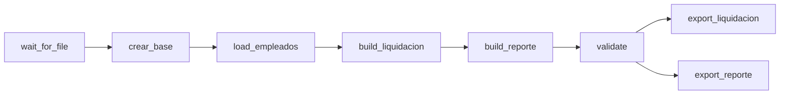

# Liquidación de sueldos – Pipeline con Apache Airflow, Docker y SQL Server

Pipeline ETL orquestado con **Apache Airflow** que corre completo dentro de Docker: lee un CSV de empleados, lo carga en un SQL Server (también en un contenedor), calcula la liquidación de sueldos con T-SQL, valida el resultado y exporta los CSV finales.

**Autor:** Augusto Caceres

## Arquitectura

Todo se levanta con un único `docker-compose.yml`:

| Servicio | Imagen | Para qué sirve | Puerto en tu PC |
|---|---|---|---|
| `sleek-airflow` | `apache/airflow:latest` | Airflow en modo `standalone` (webserver, scheduler y procesador de DAGs) | 8080 |
| `sqlserver` | `mcr.microsoft.com/mssql/server:2022-latest` | Base de datos del pipeline (usuario `sa`) | 14330 |
| `postgres` | `postgres:16` | No lo usa este pipeline: quedó de ejercicios anteriores | 5432 |

Airflow se conecta a SQL Server por la red interna de Docker, con el nombre `sqlserver` y el puerto 1433. El puerto 14330 es solo para conectarte desde tu PC con SSMS, DBeaver o VS Code y mirar las tablas.

> La Windows Authentication no funciona desde un contenedor Linux. Por eso este proyecto usa autenticación de SQL Server (usuario `sa`) en lugar de `Trusted_Connection`.

## Flujo del DAG

El DAG `liquidacion_sueldos_sqlserver` tiene 8 tareas. Las dos exportaciones corren en paralelo.



| Tarea | Tipo | Qué hace |
|---|---|---|
| `wait_for_file` | `FileSensor` | Espera a que aparezca `empleados.csv` en `carpeta1` (revisa cada 10 segundos, con un tiempo máximo de 60) |
| `crear_base` | `@task` | Crea la base `TestDB` si no existe (se conecta a `master`) |
| `load_empleados` | `@task` | Lee el CSV, lo carga tal cual en `stg_Empleados` y devuelve la cantidad de filas por XCom |
| `build_liquidacion` | `SQLExecuteQueryOperator` | 9 sentencias T-SQL que limpian los datos y calculan antigüedad, bonos, horas extra, bruto, aportes, neto y cuartil |
| `build_reporte` | `SQLExecuteQueryOperator` | Arma la tabla `reporte_departamentos` |
| `validate` | `@task` | Compara las filas de `liquidacion` con el XCom de la carga y busca netos nulos o menores o iguales a 0. Si algo falla, termina con error |
| `export_liquidacion` | `@task` | Exporta `liquidacion_<fecha>.csv` a `carpeta2` |
| `export_reporte` | `@task` | Exporta `reporte_departamentos.csv` a `carpeta2` |

## Estructura del proyecto

```
.
├── docker-compose.yml
├── dags/
│   └── liquidacion_sueldos_sqlserver_dag.py
├── carpeta1/
│   └── empleados.csv            # entrada
├── carpeta2/                    # salida (CSV generados)
├── plugins/                     # vacía; la monta el compose
└── airflow_meta/                # se genera sola: base de Airflow, configuración y contraseña de admin
```

Los volúmenes del compose conectan esas carpetas con `/opt/airflow` dentro del contenedor.

## Requisitos

- Docker Desktop (con Docker Compose).
- Unos 4 GB de RAM libres para Docker: SQL Server necesita al menos 2 GB.
- Conexión a internet en el primer arranque, para bajar las imágenes (la de SQL Server pesa cerca de 1.5 GB) y que Airflow instale sus providers.

## Puesta en marcha

1. **Clonar el repositorio** y copiar `empleados.csv` a `carpeta1/`.

2. **Levantar los contenedores:**

   ```bash
   docker compose up
   ```

   El primer arranque tarda varios minutos. Mientras Airflow termina de iniciar, `localhost:8080` puede mostrar `ERR_EMPTY_RESPONSE`: es normal. En los logs de `sqlserver` tiene que aparecer `SQL Server is now ready for client connections`.

3. **Entrar a Airflow** en [http://localhost:8080](http://localhost:8080) con el usuario `admin`. La contraseña se genera en el primer arranque y queda guardada en `airflow_meta/simple_auth_manager_passwords.json.generated`.

4. **Crear las dos conexiones** (menú Navegar → Connections → `+`):

   | Campo | `mssql_default` | `fs_default` |
   |---|---|---|
   | Connection Type | Microsoft SQL Server | File (path) |
   | Host | `sqlserver` | |
   | Schema | `TestDB` | |
   | Login | `sa` | |
   | Password | el valor de `MSSQL_SA_PASSWORD` del compose | |
   | Port | `1433` (el interno de Docker, no el 14330) | |
   | Path | | `/` |

5. **Variables** (opcional, en Navegar → Variables). Si no existen, el DAG usa los valores por defecto:

   | Variable | Qué es | Valor por defecto |
   |---|---|---|
   | `fecha_liquidacion` | Fecha hasta la cual se cuenta la antigüedad | `2026-10-31` |
   | `pct_aportes` | Porcentaje de aportes sobre el bruto | `17` |

6. **Ejecutar el DAG:** buscar `liquidacion_sueldos_sqlserver` en la lista de DAGs y apretar **Trigger**. No tiene horario: corre solo cuando se lo dispara a mano.

## Verificar los resultados

- Las 8 tareas deben quedar en verde.
- El log de `validate` tiene que decir `Filas en el CSV: 16 | Filas en liquidacion: 16 | Netos invalidos: 0`.
- En `carpeta2/` aparecen `liquidacion_2026-10-31.csv` y `reporte_departamentos.csv`.
- Para ver las tablas, conectate a `localhost,14330` con usuario `sa` y la base `TestDB`.

## Reglas de negocio

| Concepto | Regla |
|---|---|
| Evaluación vacía | Se toma como 3 |
| Antigüedad | Años completos cumplidos hasta la fecha de liquidación |
| Bono por antigüedad | 2% del salario base por año, con un tope de 20% |
| Bono por evaluación | 5 → 15%, 4 → 10%, 3 → 5%, 1 o 2 → 0% del salario base |
| Horas extra | `horas_extra × (salario_base / 160) × 1.5` |
| Salario bruto | Salario base + bono por antigüedad + bono por evaluación + horas extra |
| Aportes | `pct_aportes`% del salario bruto |
| Salario neto | Salario bruto − aportes |
| Cuartil | De 1 a 4 según el neto, donde 1 son los más bajos |
| Redondeo | 2 decimales en cada bono, en las horas extra y en los aportes |

## Resultados esperados

Con los datos de ejemplo, `fecha_liquidacion = 2026-10-31` y `pct_aportes = 17`:

- `liquidacion` tiene 16 filas. Totales: bruto 28251656.25, aportes 4802781.57, neto 23448874.68.
- Maria Lopez: neto 1867500.00 y cuartil 4. Diego Sosa tiene 5 años de antigüedad y Camila Diaz 4.
- Romina Paz: aportes 223348.13 y neto 1090464.37.

| Departamento | Empleados | Masa bruta | Neto promedio | Participación | Mayor neto | Empleado |
|---|---|---|---|---|---|---|
| SISTEMAS | 5 | 11119500.00 | 1845837.00 | 39.4 | 2776350.00 | Martin Gomez |
| VENTAS | 5 | 8671312.50 | 1439437.87 | 30.7 | 1867500.00 | Maria Lopez |
| LOGISTICA | 3 | 4624218.75 | 1279367.19 | 16.4 | 1452500.00 | Hernan Ruiz |
| RRHH | 3 | 3836625.00 | 1061466.25 | 13.6 | 1305590.00 | Valentina Lopez |

Si cambiás `pct_aportes` (por ejemplo a `20`) y volvés a disparar el DAG, los aportes y los netos tienen que cambiar.

## Detalles de implementación

- **Parámetros con Jinja.** La fecha y el porcentaje se leen de las Variables de Airflow dentro del SQL con `{{ var.value.get('fecha_liquidacion', '2026-10-31') }}`, con un valor por defecto. En las tareas de Python se usa `Variable.get(..., default=...)`.
- **XCom.** `load_empleados` devuelve la cantidad de filas cargadas y `validate` la recibe para compararla con las filas de `liquidacion`.
- **Carga tal cual.** El CSV se carga sin limpiar en `stg_Empleados`, y toda la limpieza y la lógica de negocio están en SQL, como en la versión sin Airflow.
- **Pasos SQL ordenados.** Las 9 sentencias de `build_liquidacion` van en un orden fijo, y cada una usa lo que calculó la anterior (bruto, aportes y neto no pueden calcularse en la misma sentencia).
- **Persistencia.** La configuración de Airflow (conexiones, variables, historial) queda en `airflow_meta/`, y los datos de SQL Server en el volumen `sqlserver_data`.

## Problemas frecuentes

| Problema | Qué revisar |
|---|---|
| El DAG no aparece en la lista | Esperar a que Airflow termine de iniciar y ver `docker compose logs sleek-airflow`. Si algún provider no se pudo instalar, el error aparece en esos logs |
| El provider de SQL Server (`pymssql`) no se instala | Revisar el log de arranque de `sleek-airflow`: ahí se ve el error de `pip` |
| `wait_for_file` falla por tiempo | Verificar que `empleados.csv` esté en `carpeta1/` y que la conexión `fs_default` tenga `Path` en `/` |
| `crear_base` falla | Crear la base a mano: conectarse a `localhost,14330` con `sa` y ejecutar `CREATE DATABASE TestDB;`. Después volver a disparar el DAG |
| Una tarea falla por la conexión | Revisar que `mssql_default` tenga host `sqlserver`, puerto `1433`, schema `TestDB` y la misma contraseña del compose |
| Quiero empezar de cero | `docker compose down` conserva los datos. Con `docker compose down -v` se borran también los volúmenes con nombre (los datos de SQL Server y Postgres) |

## Seguridad y GitHub

- La contraseña `sa` del compose es **solo para práctica local**. Para otros usos conviene guardarla en un archivo `.env` fuera del repositorio.
- No subir `airflow_meta/` al repositorio: contiene la base de datos de Airflow y la contraseña de admin generada. Agregarlo a `.gitignore`:

  ```
  airflow_meta/
  carpeta2/
  __pycache__/
  ```
- El compose usa `apache/airflow:latest` y el DAG está escrito con la API de Airflow 3 (`airflow.sdk`). Para que el proyecto no se rompa con versiones futuras, conviene fijar una versión concreta de la imagen.

## Limitaciones y posibles mejoras

- El email y el formato del nombre suponen que cada nombre tiene exactamente dos palabras.
- El servicio `postgres` y los providers de otros ejercicios que instala el compose no son necesarios para este pipeline y se pueden quitar.
- Agregar un horario (`schedule`) para que el DAG corra solo, por ejemplo una vez por mes.
- Agregar pruebas automáticas que comparen los resultados con los valores esperados.
